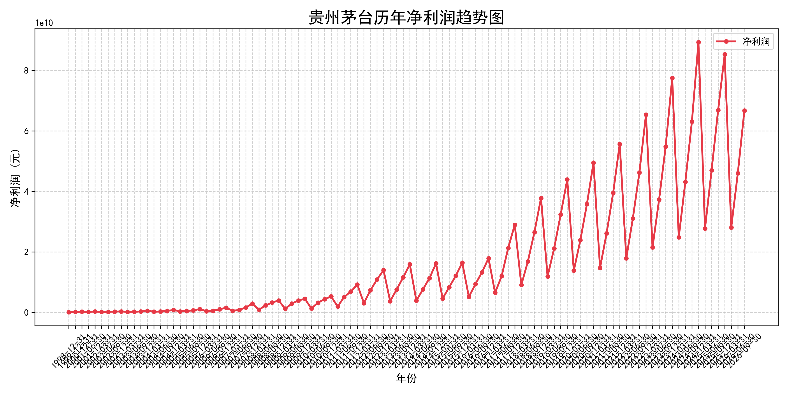

# 贵州茅台财务数据自动化分析项目 (Financial Data Analysis)

## 📌 项目简介
本项目基于 Python 与 Pandas 库，实现了对贵州茅台（600519）历年财务数据的自动化抓取、清洗与可视化分析。

## 🛠️ 技术栈
*   **数据获取**: `akshare` (获取真实财报接口)
*   **数据处理**: `pandas`, `numpy`
*   **数据可视化**: `matplotlib`

## 📊 核心产出
下图展示了茅台自 1998 年以来的净利润趋势。由于是季度数据，图形呈现明显的季节性波动（春节前后利润激增），并伴随长期强劲的上升趋势：

## ⚙️ 运行说明
1. 安装依赖：`pip install pandas numpy akshare matplotlib`
2. 运行 `step1_get_data.py` 抓取原始数据
3. 运行 `step2_clean_data.py` 进行数据清洗
4. 运行 `step3_visualize.py` 生成图表